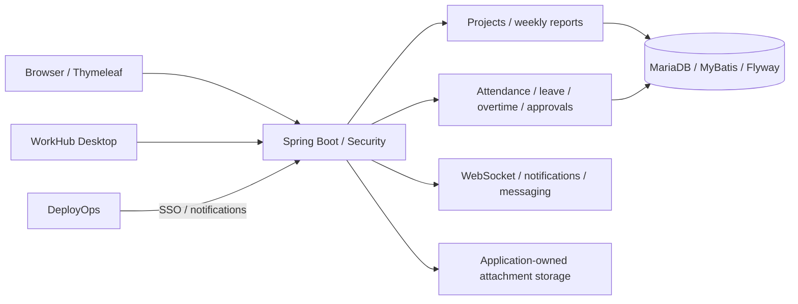

# WorkHub

프로젝트 작업, 주간보고, 근태·휴가·결재, 사내 소통을 한 서버에서 처리하는 Java 업무 서버 포트폴리오입니다. WorkHub connects project work, weekly reporting, attendance, approvals and messaging in one server.

     

[포트폴리오](https://beom.it/ko#projects) · [Portfolio in English](https://beom.it/en#projects) · [공개 데모](https://work.beom.it) · [아키텍처 설계도](https://beom.it/ko/projects/workhub?view=architecture) · [아키텍처 PDF](docs/architecture/Office_System_아키텍처_포트폴리오.pdf)


## 주요 기능 / Features

**프로젝트와 주간보고**

- 프로젝트별 참여자·담당자·협업자, 보드와 목록, 진척도·체크리스트
- 근거 자료(링크·파일), 작업 댓글, 활동 기록, 수락 기반 인수인계
- 그 주의 프로젝트 활동을 개인 주간보고 초안에 자동 반영, 보고용 보충 설명
- 개인 제출 → 팀 취합 → 전체 확정, 제출된 보고서 보존, 검색과 인쇄

**근태·휴가·결재**

- 출퇴근 기록과 판정, 근태 정정 신청, 월 마감, 근무조와 근태 정책
- 연차 부여·차감 원장, 휴가 종류, 휴직, 퇴사자 정산
- 시차출근, 출장 신청과 출장 보고서, 외근 신청
- 시간외 근무: 산정 기준, 신청 결재, 시간외 출퇴근 기록, 월 집계와 수당 계산
- 직책·조직별 결재 경로, 수신 부서, 대리 승인, 결재 문서 보관

**인사·조직**

- 조직도, 직원 등록·인사카드, 인사정보 변경 이력, 인사이동(예약 발령 포함)
- 직급 트리(값 + 단위)와 직급별 통상시급 이력, 급여 관리
- 관리자 메뉴별 권한 부여와 부여 이력

**소통과 연동**

- 공지·투표, 알림, 업무 메모, 1:1·그룹 대화, 내 상태(온라인·자리비움), WebSocket 실시간 패널
- 세션·OTP·비밀번호 변경 강제, 로그인 시도 제한
- WorkHub Desktop(Windows 앱) API: 로그인·기기 토큰, 출퇴근, 미신청 시간외 안내, 설치·패치 파일 배포
- DeployOps 연동: 계정 연결(SSO), 배포 알림 수신

직원 평가 모듈은 이 공개판 범위에 넣지 않았습니다. 과거 스키마는 초기 마이그레이션에 그대로 두고 `V95__portfolio_scope.sql` 에서 정리합니다.



## 빌드와 테스트 / Build and test

JDK 21, Maven Wrapper, Node.js 22 이상이 필요합니다. 전체 Java 테스트는 Docker 와 일회용 MariaDB Testcontainers 를 사용합니다. 테스트 DB 는 테스트마다 분리되며 기존 DB 연결 설정을 쓰지 않습니다.

```powershell
.\mvnw.cmd -B -ntp test
node --test src/test/js/*.test.cjs
```

Linux 에서는 `sh ./mvnw -B -ntp test` 로 실행합니다. Docker 엔진과 테스트 클라이언트의 API 버전은 `src/test/resources/docker-java.properties` 의 `api.version` 으로 맞춥니다.

## 로컬 실행 / Run locally

```powershell
Copy-Item .env.example .env   # 값을 모두 바꾼 뒤 실행
docker compose up -d --build
```

`workhub-db`(MariaDB)와 `workhub`(앱) 컨테이너가 뜨고, 빈 DB 에 Flyway 마이그레이션 V1~V97 이 적용됩니다. `SUPER_ADMIN_USERNAME`·`SUPER_ADMIN_PASSWORD` 를 주면 첫 기동 때 관리자 계정을 하나 만듭니다.

## 설정 / Configuration

기본값은 `src/main/resources/application.yml` 에 있고, 아래 환경 변수로 바꿉니다. 실제 비밀값은 저장소에 넣지 않습니다.

| 목적 | 환경 변수 (속성) |
| --- | --- |
| DB | `DB_URL`, `DB_USER`, `DB_PASSWORD` (`spring.datasource.*`) |
| 최초 관리자 | `SUPER_ADMIN_USERNAME`, `SUPER_ADMIN_PASSWORD`, `SUPER_ADMIN_NAME` (`app.bootstrap.super-admin.*`) |
| 신규 계정·초기화 비밀번호 | `WORKHUB_INITIAL_PASSWORD` (`app.accounts.initial-password`, 12자 이상) |
| 익명 기능 HMAC | `ANONYMITY_SECRET` (`app.anonymity.secret`) |
| DeployOps 연동 | `DEPLOY_SYSTEM_URL`, `DEPLOY_SSO_SHARED_SECRET` (`app.deploy-sso.*`) |
| 업로드 | `PROFILE_IMAGE_DIR`, `SIGNATURE_IMAGE_DIR`, `NOTICE_IMAGE_DIR`, `PROJECT_ATTACHMENT_DIR`, `MESSAGE_ATTACHMENT_DIR`, `APP_RELEASE_DIR`, `APPROVAL_DOCUMENT_DIR`, `TRIP_RECEIPT_DIR`, `LOGO_DIR` (`app.upload.*`) |
| 로그 | `APP_LOG_DIR` (`app.log.dir`) |
| 공개 데모 | `PORTFOLIO_PUBLIC_DEMO`, `PORTFOLIO_DEMO_PASSWORD` (`app.portfolio.*`) |
| 데모 저장 한도 | `PORTFOLIO_STORAGE_ROOT`, `PORTFOLIO_STORAGE_MAX_BYTES` |

샘플 조직과 사용자는 모두 가상 데이터입니다(`demo.*` 계정). SQL 에는 로그인할 수 없는 비밀번호 표식만 있고 고정 해시는 없습니다. 일반 실행의 관리자는 위 부트스트랩 설정으로 따로 만들고, 신규 직원의 초기 비밀번호는 관리자가 안전한 경로로 전달하며 첫 로그인 때 바꿔야 합니다.

### 공개 데모 모드

`PORTFOLIO_PUBLIC_DEMO=true` 로 켭니다. 이 모드는 전용 DB(`workhub_demo`)와 12자 이상의 데모 비밀번호를 마이그레이션 전에 확인하고, 가상 계정만 활성화해 데모 비밀번호를 로그인 화면에 보여 줍니다. 이미 있는 비밀번호는 덮어쓰지 않습니다. 계정·권한·보안 설정 변경, 설치 파일 배포, Desktop API, 외부 연동은 막힙니다.

공개 데모에서는 위의 업로드 디렉터리를 모두 명시적으로 설정하고 `PORTFOLIO_STORAGE_ROOT` 안에 두어야 합니다. 빠진 설정, root 밖 경로, 심볼릭 링크가 있으면 기동을 거부하고, 저장된 파일은 하나의 용량 한도에 합산됩니다.

## Windows 앱 연동 규약

- API 경로는 `/api/desktop/**`, 브라우저 전환은 `/desktop/sso/**` 입니다.
- 관리자가 올린 설치·패치 파일은 `Portfolio.OfficeSystem-Setup-<버전>.exe`, `Portfolio.OfficeSystem-Patch-<버전>.zip` 이름으로 저장·배포합니다.

## 마이그레이션

V1~V94 는 기능 개발 순서대로의 스키마이고, 샘플 데이터는 가상 조직·인물로 바꿨습니다. V95 는 공개판 범위 정리, V96~V97 은 프로젝트 관리와 주간보고 연계입니다. 새로 만든 개발 DB 에 적용하는 기준이며, 기존 설치의 마이그레이션 이력을 덮어쓰는 용도가 아닙니다.

## 출처와 라이선스

프로젝트 소스에 대한 새로운 포괄적 사용 허락은 이 저장소에서 부여하지 않습니다. 포함한 서드파티 리소스의 고지와 라이선스는 [THIRD_PARTY_NOTICES.md](THIRD_PARTY_NOTICES.md)에 보존합니다.
