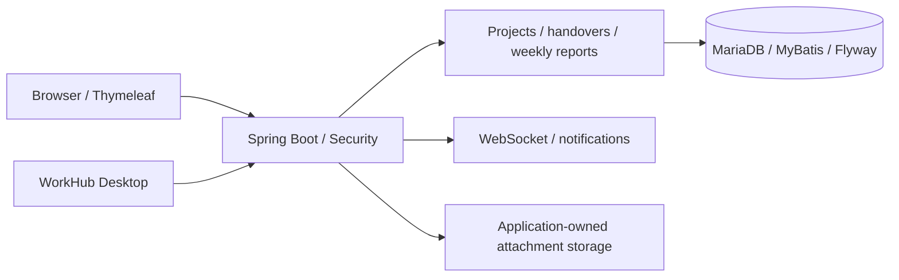

# WorkHub

프로젝트 작업과 단건 주간보고를 연결하는 Java 업무 서버 포트폴리오입니다. WorkHub connects project ownership, task progress, handovers and weekly reporting in one workflow.

[포트폴리오](https://beom.it/ko#projects) · [Portfolio in English](https://beom.it/en#projects) · [공개 데모](https://work.beom.it)

## 주요 기능 / Features

- 프로젝트별 참여자·담당자·협업자, 보드와 목록, 진척도·체크리스트
- 근거 자료·작업 댓글·활동 기록과 수락 기반 인수인계
- 해당 주의 프로젝트 활동을 단건 주간보고 초안에 반영
- 제출된 보고서 보존, 조직별 보고·확인 권한
- 업무 알림, 실시간 패널, 근태·휴가 및 조직 관리
- 세션·OTP·비밀번호 변경 강제, Windows 앱 인증과 기기 토큰

평가·KPT·KPI 모듈은 현재 공개 제품 범위에 포함하지 않습니다. 과거 스키마를 정리하는 마이그레이션은 남아 있습니다.



## 빌드와 테스트 / Build and test

JDK 21, Maven Wrapper, Node.js 22 이상이 필요합니다. 전체 Java 테스트는 Docker와 일회용 MariaDB Testcontainers를 사용합니다. 테스트 DB는 테스트마다 분리되며 기존 DB 연결 설정을 사용하지 않습니다.

```powershell
.\mvnw.cmd -B -ntp package
node --test src/test/js/*.test.cjs
```

Linux에서는 `sh ./mvnw -B -ntp package`로 실행합니다. Docker 엔진과 테스트 클라이언트의 API 호환성 설정 이름은 `api.version`입니다. 필요할 때 실행 환경에서 제공하며 연결 설정 파일은 저장소에 넣지 않습니다.

## 외부 설정 / External configuration

환경 파일, YAML, 연결 정보와 비밀번호 예제는 제공하지 않습니다. 아래는 외부에서 제공할 설정 이름입니다.

| 목적 | 설정 이름 |
| --- | --- |
| 전용 DB | `spring.datasource.url`, `spring.datasource.username`, `spring.datasource.password` |
| 최초 관리자 | `app.bootstrap.super-admin.username`, `app.bootstrap.super-admin.password`, `app.bootstrap.super-admin.name` |
| 최초 관리자 환경변수 별칭 | `SUPER_ADMIN_USERNAME`, `SUPER_ADMIN_PASSWORD`, `SUPER_ADMIN_NAME` |
| 익명 기능 HMAC | `app.anonymity.secret`, `ANONYMITY_SECRET` |
| 신규 계정·관리자 초기화 | `app.accounts.initial-password`, `WORKHUB_INITIAL_PASSWORD` |
| 선택적 DeployOps 연동 | `app.deploy-sso.base-url`, `app.deploy-sso.shared-secret`, `DEPLOY_SYSTEM_URL`, `DEPLOY_SSO_SHARED_SECRET` |
| 업로드 | `app.upload.profile-dir`, `app.upload.signature-dir`, `app.upload.notice-dir`, `app.upload.project-attachment-dir`, `app.upload.message-attachment-dir`, `app.upload.release-dir`, `app.upload.approval-document-dir`, `app.upload.trip-receipt-dir`, `app.upload.logo-dir` |
| 로그 | `app.log.dir` |
| 공개 데모 선택 | `app.portfolio.public-demo`, `PORTFOLIO_PUBLIC_DEMO`, `PORTFOLIO_DEMO_PASSWORD` |
| 데모 저장 한도 | `app.portfolio.storage-root`, `app.portfolio.storage-max-bytes` |

샘플 조직과 사용자는 가상 데이터입니다. SQL에는 인증할 수 없는 비밀번호 표식만 있으며 고정 해시는 없습니다. 일반 실행의 관리자는 외부 부트스트랩 설정으로 별도 생성합니다. 신규 직원의 초기 비밀번호는 관리자가 안전한 경로로 전달하고 첫 로그인 후 변경해야 합니다.

공개 데모는 전용 DB와 외부 비밀번호를 마이그레이션 전에 확인합니다. 해당 모드에서만 가상 계정을 활성화하고 데모 비밀번호를 로그인 화면에 보여줍니다. 기존 비밀번호를 시작할 때 덮어쓰지 않습니다. 계정·보안 설정, 설치 파일 배포, Desktop API와 외부 연동은 공개 데모에서 제한됩니다.

공개 모드에서는 위의 모든 업로드 디렉터리를 명시적으로 설정하고 `app.portfolio.storage-root` 안에 배치해야 합니다. 빠진 설정, root 밖 경로 또는 심볼릭 링크가 있으면 기동을 거부합니다. 이렇게 저장된 파일이 동일한 용량 한도에 합산됩니다.

이 소스의 정제된 초기 마이그레이션은 새로 준비한 개발 DB에 적용하는 기준입니다. 기존 설치의 마이그레이션 이력을 변경하거나 덮어쓰는 용도로 사용하지 않습니다. 실제 연결 설정과 배포 구성은 별도로 준비해야 합니다.

## 출처와 라이선스

프로젝트 소스에 대한 새로운 포괄적 사용 허락은 이 저장소에서 부여하지 않습니다. 포함한 서드파티 리소스의 고지와 라이선스는 [THIRD_PARTY_NOTICES.md](THIRD_PARTY_NOTICES.md)에 보존합니다.
